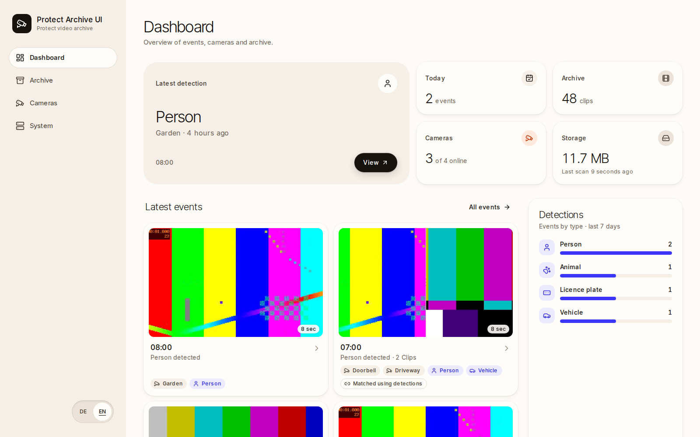
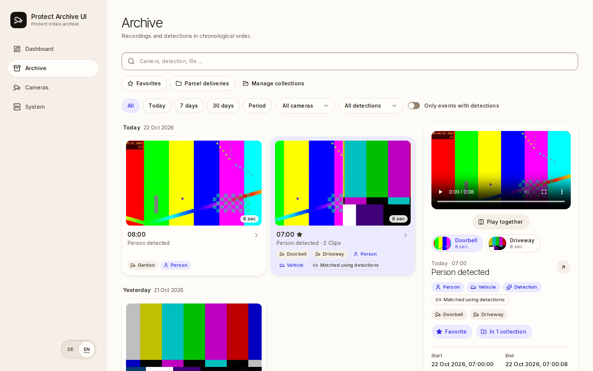

# Protect Archive UI

A self-hosted web app for browsing, searching and watching the UniFi Protect recordings you
already export to a NAS. It reads your existing MP4 files and never changes them. It does not
record cameras or replace your NVR.



This is an independent project. It is not affiliated with or supported by Ubiquiti.

## What you get

- One place to browse and search your archived recordings by camera, date and detection type.
- Video playback with seeking, plus preview images.
- Play two clips of an event side by side, synchronized by recording time (since v1.1.0).
- Mark events as favorites and organize them in your own collections, then filter the archive by them (since v2.0.0).
- An optional connection to your UniFi Protect console for camera names and detection events.
- Clips from the same situation but from different cameras are automatically aggregated and displayed as one. Clips can then be viewed independently (since v1.0.1 also without a connection to the Protect server, based on the camera names in the file names)




## Requirements

- A Linux (amd64) server with Docker Engine 28 or later and the Docker Compose plugin.
- Your UniFi Protect MP4 exports, mounted on that server (for example from a NAS).

Everything else (database, ffmpeg, Node.js) is included in the containers.

## Quick start

```bash
mkdir unifi-archive && cd unifi-archive
curl -fsSLO https://raw.githubusercontent.com/dree007/unifi-protect-archive-ui/v2.0.0/docker-compose.yml
curl -fsSL -o .env https://raw.githubusercontent.com/dree007/unifi-protect-archive-ui/v2.0.0/.env.example
chmod 600 .env
```

Open `.env` and set at least:

- `POSTGRES_PASSWORD`: a long random password for the internal database.
- `NAS_ARCHIVE_HOST_PATH`: the folder on the server that contains your recordings.

Then start the app:

```bash
docker compose up -d
```

Open `http://<your-server-ip>:3100` in your browser. The app starts indexing your recordings
right away. The common settings are explained in [.env.example](.env.example), advanced ones in
[docs/selfhosting.md](docs/selfhosting.md#configuration).

## Keep it private

The app has **no login** and uses plain HTTP. Anyone who can reach port 3100 can watch your
recordings. Only use it in a trusted network, never forward the port from your router, and put
an authenticating HTTPS proxy or VPN in front of it for any other access.
Read [SECURITY.md](SECURITY.md) before you install.

## Documentation

- [Self-hosting guide](docs/selfhosting.md): installation, configuration, updates, backups and troubleshooting
- [Access security](docs/security.md): network access, reverse proxy and login gateways
- [Changelog](CHANGELOG.md)

## Support

Version 2.0.0 is built and tested for Linux amd64 with synthetic recordings and a simulated
Protect console. Real NAS setups, Protect versions, HTTPS proxies and single sign-on vary and are
not individually tested.

Bug reports and ideas are welcome as GitHub issues. Please report security problems only
privately, as described in [SECURITY.md](SECURITY.md).

## License

Protect Archive UI is licensed under [AGPL-3.0-only](LICENSE). Third-party components keep
their own licenses; see [THIRD_PARTY_NOTICES.md](THIRD_PARTY_NOTICES.md),
[licensing](docs/licensing.md) and [native sources](docs/native-sources.md).
